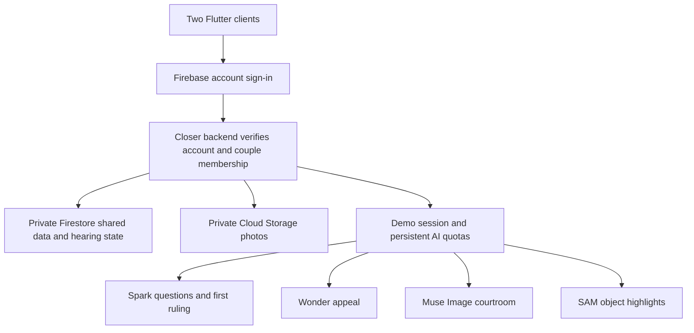

# Closer — a shared space for two

Closer brings a couple’s shared space into one app: an opt-in live map, private chat with photos and replies, a shared memories album, and Couple Court. The app is intended for Android and iOS phones.

Each person signs in on their own phone. One creates a one-time partner invitation; the other joins it. After pairing, messages, photos, memories, location updates and court summons stay in the same shared space, so the couple does not create a new room for each visit.

## Features

- **Map:** OpenStreetMap tiles, distance between shared positions, and location sharing that each partner enables separately. Sharing stops when the app backgrounds.
- **Chat:** Shared messages, photo attachments, replies, hearts and court summons.
- **Memories:** A shared photo album with captions.
- **Couple Court:** Shared cases with evidence, timed turns, questions, AI-proposed remedies and an appeal flow.
- **Us:** Couple profile, relationship date, AI access and sign-out.

## Run and build

```powershell
flutter pub get
powershell -NoProfile -ExecutionPolicy Bypass -File tool/run-android.ps1
powershell -NoProfile -ExecutionPolicy Bypass -File tool/build-release.ps1
```

Build the iOS app on a Mac with Xcode: `flutter build ios --release`.

The connected app uses Firebase Authentication for accounts and the Closer backend for paired data. Set `BACKEND_URL` when building your own backend deployment. Never include a Meta API key in the app; model requests stay on the backend.


## Why Closer

Small disagreements can become competing accounts of the same moment. Couple Court gives both partners a structured chance to speak, ask questions and share context. The courtroom makes that process playful; outcomes are voluntary suggestions for everyday disagreements. Closer is not a legal service, therapy or a personality analyzer.

## What works

| Section | Connected behavior |
| --- | --- |
| Map | Zoomable OpenStreetMap street tiles, explicit GPS permission, per-person location sharing, last-update labels and distance between shared positions |
| Chat | Messages, photos, replies, reactions and court summons shared between the paired accounts |
| Memories | Captions and private photos available to both partners |
| Court | Both partners join the same case; server-enforced roles/deadlines, photo evidence, cross-examination, questions, real AI ruling and one appeal |
| Closer | Account sign-in/sign-out, one-time partner invitations, names, anniversary and private AI demo access |

Updates are polled while the app is active: shared space every eight seconds, an open hearing every five. This is not a claim of instant delivery or read receipts. The current view shows the latest 150 messages/memories. Location updates run only while the map is open and the app is foregrounded; last-known positions remain until removed. Push notifications and background location tracking are not implemented.

## Run it

```sh
flutter pub get
powershell -NoProfile -ExecutionPolicy Bypass -File tool/run-android.ps1
```

The public backend address is configured by default. Override it when hosting your own copy:

```sh
powershell -NoProfile -ExecutionPolicy Bypass -File tool/run-android.ps1 --dart-define=BACKEND_URL=https://YOUR_BACKEND
```

On the original Windows development PC, a corrupted shared Gradle cache was found. The helper below uses an isolated, Git-ignored cache. Start an Android emulator or connect a phone first:

```powershell
powershell -NoProfile -ExecutionPolicy Bypass -File tool/run-android.ps1
```

Firebase initialization uses the platform options in `lib/firebase_options.dart`. Firebase app identifiers/API configuration identify the app and are not the private Meta key. Android and iOS use **`com.jcm.closer`**; the Dart package is **`closer`**. For your own deployment, configure your own Firebase apps and backend rather than relying on the author's hosted service.

iOS project files are included; building, signing and validating the iOS app requires macOS with Xcode.

## Pair two phones

1. Install the app on both phones and create separate email/password accounts.
2. Enter your own name on each phone.
3. One partner creates a private, one-use invitation and shares it with the other. It expires after 24 hours.
4. The other partner enters the invitation. Pairing is committed atomically; neither account can be paired twice.
5. Both accounts now open the same shared space on subsequent sign-ins.

Existing device-only prototype messages are not automatically uploaded. Account deletion, unpairing, retention/export controls and production hardening remain roadmap work. Use fictional or non-sensitive material for the demo.

## How we use Meta AI

All model calls go through the private backend to **Meta Model API** at `https://api.meta.ai/v1/responses`. No Meta key is shipped in Flutter. There is no non-Meta runtime fallback.

| Model | Role | What it receives and returns |
| --- | --- | --- |
| Muse Spark `muse-spark-1.3` | First judge | Full case record plus original evidence images → clarification questions and an explained remedy proposal |
| Muse Wonder `muse-wonder-1.0` | Appeal judge | Prior ruling, appeal grounds, other participant's response and original evidence → upheld or revised proposal |
| Muse Image `muse-image-1.0` | Courtroom artist | Courtroom reference and two separately consented portraits → a complete pixel-art scene, shared with both partners |
| SAM 3.1 `sam-3.1` | Optional exhibit highlights | An exhibit plus a concrete object phrase → validated object boxes shown over the unchanged photo |

### A shared hearing

The claimant opens a summons from chat. Both participants enter. The server assigns claimant/respondent from the summons author and enforces each speaking role, a two-minute deadline and version checks. Expired turns are explicitly marked unanswered; late testimony is not invented or accepted. Submitted records survive leaving and reconnecting.

The flow includes the requested remedy, both openings, cross questions and answers, rebuttals, Spark clarification questions and answers, a first ruling, and one respondent appeal reviewed by Wonder. Both accounts must separately approve an agreement. Either can decline and close unresolved. An appeal resets prior approvals.

Evidence photos belong to their submitting participant. Up to two per person, four total, at most 1 MB each. Spark and Wonder receive actual image input blocks alongside exhibit IDs/captions; portraits used for character art are excluded. Structured responses must address every exhibit and preserve the original requested remedy. The judge is prompted to distinguish visible observations from allegations and to explain uncertainty rather than authenticate screenshots or infer motive from appearance.

Before entering court, each participant can separately consent to adding their own portrait for Muse Image. The generated scene is shared private artwork, with model/response metadata. No photographic face overlays are used. SAM highlights are optional visual aids; they do not establish authenticity or become evidence findings. Originals stay available.



## Backend access and privacy

The deployed API uses Cloud Run with a private Meta key mounted from Secret Manager. Firebase ID tokens protect account/shared-space endpoints; every shared operation checks couple membership. Private media is served through the backend after authorization rather than public download URLs. The backend has access to a separate named database and Closer-only photo bucket, leaving iSee's default data/rules unchanged.

Saved-place arrival and departure alerts use Firebase Cloud Messaging. Before deploying the updated backend, grant its runtime service account permission to send messages and enable the FCM API (replace `PROJECT_ID` with the Firebase/GCP project ID):

```powershell
gcloud projects add-iam-policy-binding PROJECT_ID --member="serviceAccount:closer-demo-runtime@PROJECT_ID.iam.gserviceaccount.com" --role="roles/firebasecloudmessaging.admin"
gcloud services enable fcm.googleapis.com --project=PROJECT_ID
```

Then redeploy the backend with `server/deploy.ps1`. Android uses the registered Firebase app. iOS push delivery also requires an APNs authentication key in Firebase Console → Project settings → Cloud Messaging. Place records are shared with the paired account; arrival/departure events are evaluated on the backend as new location updates arrive.

AI additionally requires a private demo code, exchanged for an expiring session inside **Closer → AI demo access**. Persistent global/invite budgets, image-generation limits, duplicate-request checks and concurrency limits apply. Ordinary shared-space requests also have per-account rate/upload limits. These safeguards are not a dollar spending cap.

The app asks for consent before model uploads. Shared app records/photos are intentionally stored for the paired users; this differs from the earlier transient AI proxy. The AI request sets `store: false`, which is not a blanket promise about Meta retention. Consult the applicable provider policies before using private material. Maps fetch tiles from OpenStreetMap; no bulk/offline download is provided. Preserve map attribution and use an appropriate tile provider for larger deployments.

## Verification

```sh
flutter analyze --no-pub
flutter test --no-pub
python -m pip install -r server/requirements-dev.txt
python -m unittest discover -s server
```

Local checks cover existing app behavior, model request validation and shared hearing turn/expiry/approval enforcement. An opt-in deployed smoke test is available as `server/smoke_shared.py`: it creates synthetic accounts, verifies pairing, cross-account chat/reactions/private photos/memories/location removal and court authorization/version checks, then removes its data/accounts. It requires operator credentials and the local Android Firebase configuration.

Live Spark and Wonder calls were verified with a fictional, photo-free case on October 31, 2026. Live Muse Image and SAM quality/geometry verification and two physical-device UI testing remain pending. See [connected-app.md](docs/connected-app.md) for setup and limits.

## Layout

```text
lib/screens/     Sign-in, pairing, real map, shared chat/memories and court
lib/models/      Cloud-backed store plus isolated legacy local test support
lib/services/    Backend/demo access and Meta clients
server/          Firebase token verification, membership, photos, hearing engine and Meta integrations
assets/          Closer branding, fonts and courtroom reference
test/            Flutter checks and visual baselines
docs/            Setup, architecture, verification and hackathon notes
tool/            Android launch helper
```

## Credits and submission

The bundled reference courtroom and Closer branding were generated using an external OpenAI image-generation tool, not Meta. Muse Image personalized scenes are separate outputs. The connected map uses OpenStreetMap tiles/data and visible attribution; the earlier offline illustration used Natural Earth. Keep bundled font/data notices and disclose reused work/assets in the hackathon submission.

Using Meta models does not guarantee hackathon eligibility. Show only verified functionality, identify event contributions, obtain consent for demo portraits/material and follow the participant guide. The repository's [LICENSE](LICENSE) governs project code; third-party assets retain their own terms.
