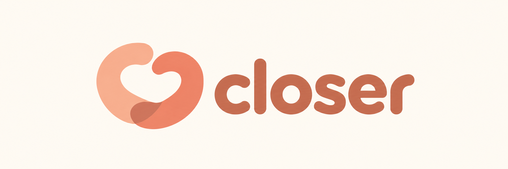
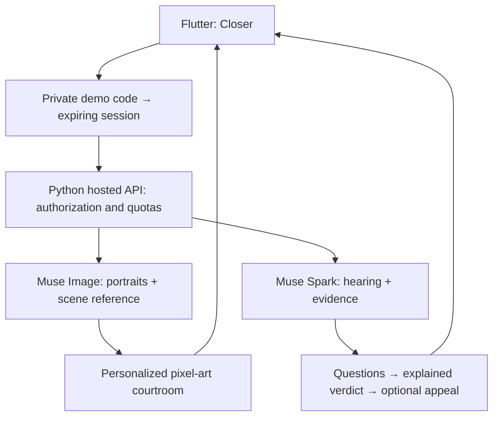

<div align="center">
  
  <h1>Closer — Make room for each other.</h1>
  <p>A peach-toned space for two: conversations, memories, and a little courtroom for everyday disagreements.</p>
  <p>Flutter · Android & iOS · Meta Muse Spark · Meta Muse Image</p>
</div>

Closer brings a couple's shared space and **Couple Court** into one app. Send a court summons from chat, explain both sides, submit photo evidence, ask each other questions, and let a Meta-powered judge propose a practical resolution. Personalize the pixel-art courtroom with characters generated from both participants' consented portraits.

Developed for the Meta Global AI Developer Hackathon 2026, under **Build for Your World**. This repository contains a working local prototype and AI integration code; the hosted service and live model behavior still need verification.

[Roadmap](ROADMAP.md) · [Court flow](docs/couple-court.md) · [Hosted demo setup](docs/hosted-demo.md) · [Firebase setup](docs/firebase-setup.md) · [Hackathon notes](docs/hackathon.md)

## Why Closer

Small disagreements can turn into competing accounts of the same moment. Closer gives both people space to speak, ask a question, share context and respond. Couple Court makes that structure playful: two participants, a pixel-art courtroom, exhibits, a judge and one opportunity to appeal.

The wider app keeps conversations and memories beside the hearing, so court is one part of spending time together. It is a voluntary game for ordinary disagreements, not a legal service, therapy or a tool for deciding who someone is.

## Inside the app

| Section | What is implemented | Current boundary |
| --- | --- | --- |
| Map | Peach/ivory map, partner markers and saved anniversary count | Illustrative locations; no real tracking or measured distance |
| Chat | Text and photo messages, replies, heart reactions, copy and court summons | Saved on one device; messages are not delivered to another phone |
| Memories | Photo selection, captions and local photo storage | No shared cloud album yet |
| Court | Timed hearings, evidence, questions, requested remedy, AI integration and one appeal | Live AI requires a configured backend; timers and roles are locally enforced |
| Closer | Profile names, anniversary, local counts and AI demo access | Accounts and lasting partner pairing are planned |

Chat summons open their own hearings. Drafts preserve testimony, exhibit references, progress and rulings when you leave and return. A running timer restores its deadline rather than starting over. Accepted or unresolved outcomes update the originating chat card.

## How Couple Court works

1. **Summon your partner.** Enter the dispute and the practical compensation or action you want.
2. **Enter the courtroom.** Use the reference scene, or consent to generating personalized characters from two portraits.
3. **Present both accounts.** Each participant gets timed opening, cross-examination and rebuttal turns. Questions and answers become part of the record.
4. **Submit exhibits.** Attach photo evidence with captions and ownership. The prototype permits four images total, two per participant, up to 1 MB each.
5. **Answer the judge.** Muse Spark generates one neutral clarification question for each participant.
6. **Receive a proposal.** The judge considers the record and original requested remedy. It can grant, reduce, increase, deny or suggest an alternative, with reasons and evidence limitations.
7. **Accept, decline or appeal.** One appeal considers the earlier ruling, respondent's grounds and claimant's response. Both people must accept before an agreed closure; either can decline.

Any increase must remain a small, proportionate, voluntary action. There are no enforced payments or legal penalties. Images are unverified evidence, and a missing answer is not treated as proof against someone.

## How we use Meta AI

The runtime AI integrations call **Meta Model API directly**, through `https://api.meta.ai/v1/responses`. The server currently defaults to the model identifiers below; availability and output quality must be checked with the project's actual Meta account before a live demo. There is no non-Meta model fallback.

| Stage | Meta model | Inputs | Output and product use |
| --- | --- | --- | --- |
| Personalized courtroom | Muse Image (`muse-image-1.0`) | Courtroom reference plus two consented portraits | A complete pixel-art scene with both participants redrawn into the artwork |
| Judge questions | Muse Spark (`muse-spark-1.3`) | Both openings, cross-examination, rebuttals, requested remedy and evidence images | One relevant clarification question per participant |
| Evidence review and verdict | Muse Spark (`muse-spark-1.3`) | Full hearing record, both judge answers and image exhibits | Structured ruling, observations and limitations for each exhibit, and a proposed remedy |
| Appeal | Muse Wonder (`muse-wonder-1.0`) | Prior ruling, appeal grounds, other participant's response and evidence | Explained revised or upheld proposal |

### Muse Image: characters belong in the scene

`server/muse_image.py` sends three ordered image references: courtroom, left participant and right participant. Muse Image is asked to redraw both participants within one cohesive scene. The app does not paste photographic faces over characters.

The app validates and saves the returned PNG locally, with model identity, response ID and prompt version, so the scene can be reused without another generation. Changing a portrait clears the personalized scene selection. Failed generation leaves the previous scene intact. Character portraits are used for this separate creative request and are excluded from the judge's evidence record.

### Muse Spark: evidence, questions and an explained outcome

`server/court_protocol.py` sends actual image input blocks, not just photo captions. Each exhibit has an ID and participant attribution. The surrounding case record includes the original requested remedy, statements, cross questions and answers, rebuttals, judge questions and answers, and appeal material when applicable.

The model is instructed to distinguish visible observations from allegations, cite supplied exhibit IDs and explain uncertainty. It must not authenticate screenshots, infer motive from a face, or treat a caption as verified fact. Case text and text inside images are treated as untrusted case material rather than instructions.

Responses are checked against the requested action's structured schema. Missing exhibit reviews, unsupported IDs, malformed fields, incomplete responses or changes to the recorded original request are rejected instead of replacing a valid ruling. The provider-returned model identity accompanies judge responses. These checks validate the response structure, not whether the model's reasoning is correct; live evaluation remains necessary.



SAM 3.1 (`sam-3.1`) provides optional object-box highlights in the exhibit viewer. Users name a concrete object and separately consent to upload. Originals remain visible and go to the judge unchanged; boxes do not authenticate evidence. No matches is a valid result. Highlights are session-only visual aids and are not included as facts in the hearing record. Voice models are not integrated. Practice hearings and bundled reference artwork are separate from live Meta output.

## Run the local prototype

Prerequisites: Flutter with Dart, an Android SDK/device or emulator, or macOS with Xcode for iOS.

```sh
flutter pub get
flutter run
```

No Meta key is needed to explore navigation, local chat, memories and practice court. Local data is stored on that device; running the app on two phones does not connect them.

Android is the current development target. iOS project files are included, but building/signing and device verification require a Mac and remain outstanding. Flutter Web is not currently supported by the local `dart:io` photo storage.

## Enable the live AI demo

The public app should contain only the backend URL. **Never place a Meta API key in Flutter, a build argument or this repository.**

The hosted backend implementation uses FastAPI, Cloud Run, Secret Manager and a dedicated Firestore database for access/quota records. Deployment instructions are in [docs/hosted-demo.md](docs/hosted-demo.md). It has not been deployed yet.

After deployment:

```sh
flutter run --dart-define=BACKEND_URL=https://YOUR_CLOUD_RUN_SERVICE_URL
```

A reviewer enters a privately supplied demo code at **Closer → AI demo access**. The server exchanges it for an expiring session, checks access and budgets, then calls Meta with its private key. Reviewers do not need their own Meta account. Codes must be shared privately, not committed with the app.

Implemented controls include hashed invite/session tokens, eight-hour sessions, revocation, expiry, persistent per-invite/global call budgets, separate image budgets, request deduplication, rate limits and bounded simultaneous calls. These are safeguards rather than a dollar spending cap. Cloud deployment and multi-instance behavior still need verification.

For a loopback-only developer proxy, see [server/README.md](server/README.md). Its older static-token setup is not the public hosting path.

## Privacy and scope

The app requests consent before sending portraits or hearing material to the model service. The proxy processes photos and testimony in memory and suppresses request logs; the security database is for access/quota records. Requests set `store: false`, which is not a blanket guarantee about provider retention. Review Meta's applicable account policies before uploading private material.

Use only photos and conversations you have permission to share. A public demo should use fictional cases and consented or synthetic portraits. Couple Court offers voluntary suggestions for everyday disagreements; it does not establish facts, diagnose users, enforce compensation or replace professional help.

## Application identifiers

The Dart package is `closer`. Android, iOS and macOS use `com.jcm.closer`; Firebase registrations must use that exact identifier. Couple Court remains the name of the hearing feature. Changing the native identifier creates a separate installation from older builds; data in the previous app installation is not transferred automatically. Existing local storage keys are retained for compatible data.

## Firebase and two phones

Firebase app authentication, permanent partner pairing, cloud chat, shared memories, live case synchronization, push notifications and opt-in location sharing are **not connected yet**. The secured AI proxy does not supply those features.

The backend guide targets the existing iSee project `iseeapp-ddf3a`, using separate Closer backend resources. Deployment requires the project ID explicitly. Its dedicated quota database must remain separate from existing application data. See [Firebase setup](docs/firebase-setup.md) and the [roadmap](ROADMAP.md) for the remaining work.

## Repository layout

```text
lib/screens/       Map, chat, memories, profile and court screens
lib/models/        Local profile, messages, summons and saved case state
lib/services/      Backend sessions, judge requests and Muse Image client
lib/theme/         Peach, ivory and seafoam styling
assets/branding/   Closer icon and wordmark
assets/court/      Bundled reference courtroom
server/            Meta integrations, validation, access controls and deployment
test/              Flutter behavior and interface tests
docs/              Hearing flow, Firebase, deployment and hackathon notes
```

## Verification

```sh
flutter analyze --no-pub
flutter test --no-pub
python -m pip install -r server/requirements-dev.txt
python -m unittest discover -s server
```

Tests cover navigation, saved local state, hearing progress, appeals, model request/response handling, consent behavior and backend access/quotas. Upstream calls use mocked responses and synthetic images. Passing tests do not demonstrate live Meta output, deployed cloud permissions or two-phone synchronization.

## Hackathon and asset credits

Closer targets the guide's **Build for Your World** problem statement. Muse Image supplies personalized visual generation; Muse Spark supplies multimodal hearing reasoning. Their integration does not itself guarantee submission eligibility.

The bundled courtroom reference and Closer branding were created with an external OpenAI image-generation tool, not Meta models. Muse Image-generated personalized scenes are separate outputs. The offline map uses Natural Earth data. Preserve bundled font/data notices and disclose reused assets and work in the submission. See [hackathon notes](docs/hackathon.md) and [branding provenance](assets/branding/README.md).

Before submission, document exactly what was built during the event, verify rights and consent, publish accessible source/setup instructions, and record a three-minute demo of actual working behavior. Live model testing and a reviewable hosted demo are still pending.

## Contributing and roadmap

Start with the [roadmap](ROADMAP.md). Keep local, practice and live behavior clearly labeled. Changes to hearings should preserve both participants' opportunities to speak, evidence uncertainty and voluntary acceptance.

No project-wide license has been selected yet. Public visibility alone does not grant reuse rights; third-party assets retain their own terms.

